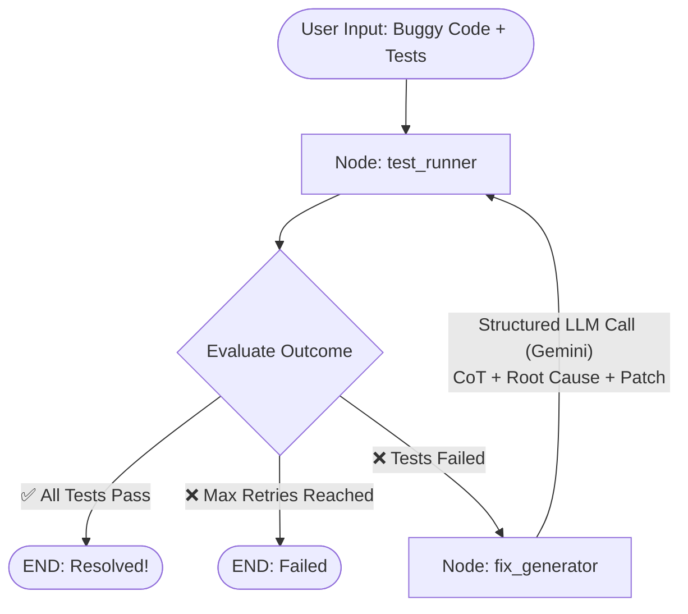

# 🐞 LangGraph BugFixer — Self-Correcting ReAct Agent

An autonomous coding agent that executes Python code against unit tests, inspects failures and stack traces, reasons about root causes, and iteratively patches bugs using **LangGraph** and **Google Gemini** (supports the Gemini Free Tier).

This is **Project 1** in the *Agentic AI Deep-Dive Curriculum*, mastering:
- **Pillar 1: Structured Reasoning & Output Enforcement** (`Pydantic` + `with_structured_output` grammar decoding)
- **Pillar 2: Evaluator-Optimizer & ReAct Feedback Loops** (Cyclic state graphs in `LangGraph`)

---

## 🏗️ Architecture & State Flow



### The State Machine (`BugFixerState`)
```python
class BugFixerState(TypedDict):
    task_description: str
    code: str
    test_code: str
    error_message: str
    iteration: int
    max_iterations: int
    status: str          # "running" | "success" | "failed"
    history: List[dict]  # Episodic memory of past failures & fixes
    last_report: Optional[dict]
```

---

## 🚀 Quickstart

### 1. Prerequisites
- Python 3.10+
- A Google Gemini API key (Free Tier from [Google AI Studio](https://aistudio.google.com/app/apikey))

### 2. Setup Virtual Environment
```bash
# Clone or navigate into the folder
cd langgraph-bugfixer

# Create and activate virtual environment
python -m venv .venv

# On Windows (PowerShell):
.\.venv\Scripts\Activate.ps1
# On Linux/macOS:
source .venv/bin/activate

# Install dependencies
pip install -r requirements.txt
```

### 3. Configure API Key
Create or edit your `.env` file:
```env
GEMINI_API_KEY=your_gemini_api_key_here
GEMINI_MODEL=gemini-2.5-flash
```

---

## 💻 Running the Application

### Option A: Interactive Menu
Run without arguments to interactively choose a challenge:
```bash
python main.py
```

### Option B: Direct Challenge Flag
```bash
# Challenge 1: Palindrome Cleaner (Edge Cases & Punctuation)
python main.py --challenge 1

# Challenge 2: Binary Search (Off-by-one Boundary Bug)
python main.py --challenge 2

# Challenge 3: Deep Nested Dict Flattener
python main.py --challenge 3
```

### Option C: Run with Custom Code & Tests
```bash
python main.py --code-file my_code.py --test-file my_tests.py --max-iterations 6
```

---

## 🔍 What You'll See in the Console
The console output is rendered using **Rich** panels:
1. **Test Runner Panel**: Shows immediate stdout/stderr and tracebacks in red.
2. **Agent Analysis Panel**:
   - 🔍 **Root Cause**: What specifically went wrong.
   - 💡 **Proposed Fix**: How the fix was designed.
   - 🧠 **CoT Reasoning**: Step-by-step logic breakdown.
   - 🎯 **Confidence Score**: Model's confidence rating.
3. **Syntax Highlighted Patch**: The formatted Python code generated by the agent.
4. **Final Summary Scorecard**: Outcome table and clean working code.

---

## 📦 Pushing to Git

To push this project to your GitHub:

```bash
# 1. Initialize git repository
git init

# 2. Add all files (the provided .gitignore safely excludes .env and .venv)
git add .

# 3. Commit
git commit -m "feat: Initial commit of LangGraph BugFixer agent"

# 4. Link to your GitHub repo (replace with your repo URL)
git branch -M main
git remote add origin https://github.com/YOUR_USERNAME/langgraph-bugfixer.git

# 5. Push
git push -u origin main
```

